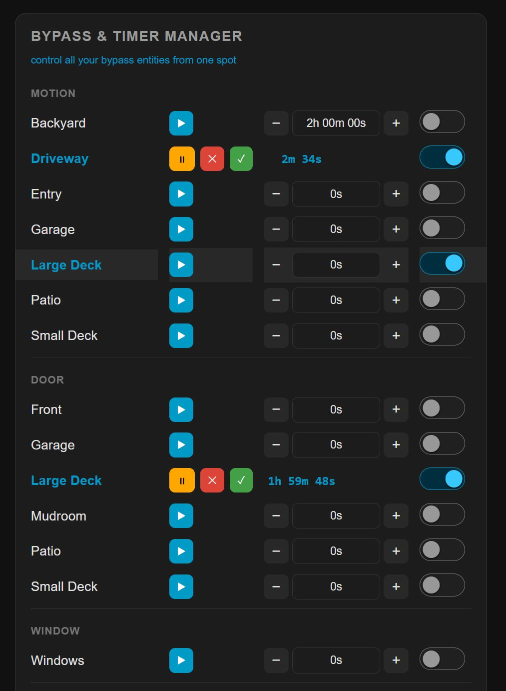

# Bypass & Timer Manager Card

[](https://my.home-assistant.io/redirect/hacs_repository/?owner=Ltek&repository=bypass-manager-card&category=plugin)

Current build: **v2026.10.15.34** · full history in [CHANGELOG.md](CHANGELOG.md)

A Home Assistant Dashboard card for **all** your bypass helpers: security zones, doors, windows,
motion, lights, scenes, locks, weather and anything else. It finds every bypass `input_boolean`
and `timer` on its own, pairs each switch with its timer, groups them by type and gives you full
timer control. There's a visual editor for every setting.



## Features

- **Finds everything itself.** No entity lists: match by entity-ID prefix (`bypass_`) or by HA label.
- **Pairs switch + timer** with the same name (`input_boolean.bypass_door_patio` ↔ `timer.bypass_door_patio`).
  A timer with no switch, or a switch with no timer, still gets a row.
- **Groups by type:** Motion, Door, Window, Light, Lock, Scene, Alarm, Weather, Other, plus your own groups.
  Or one flat list.
- **Order** by name, or active first with the newest change on top.
- **Per-row columns**, each optional: bypass icon (tap to toggle), name (tap for details), Start / Pause /
  Stop / Finish (each separately), set time with − / + steps, live countdown, timer duration, on/off switch.
- **Last changed** line per row, with the clock time if you want it.
- **Title line** with an active count ("3 active" / "All off") and an optional glow while anything is on.
- **Create and delete helpers** from the card (admins only): a Timer, a Switch, or a matched set of both,
  named the card's way (`bypass_door_patio`), in an area when grouping by area. YAML helpers are locked.
- **Groups by type or by area**, in your own order, each one shown or hidden, and optionally collapsible
  (starting open or collapsed).
- Every color follows your theme or can be custom; every size is a slider.

## Installation

### HACS (recommended)

1. Click the badge above, or in HACS open **⋮ → Custom repositories** and add this repo with type **Dashboard**.
2. Install **Bypass & Timer Manager Card**.
3. Hard-refresh the browser (`Ctrl+Shift+R`).

### Manual

1. Copy `bypass-manager-card.js` to `/config/www/community/bypass-manager-card/`.
2. **Settings → Dashboards → ⋮ → Resources** → add `/local/community/bypass-manager-card/bypass-manager-card.js`
   as a **JavaScript module**.
3. Hard-refresh the browser.

## Quick start

```yaml
type: custom:bypass-manager-card
```

That's it: every `input_boolean.bypass_*` and `timer.bypass_*` shows up, grouped.

## Groups

A bypass goes in the group of the **first type word in its name**:

| Word | Group | Icon |
|---|---|---|
| `motion` | Motion | `mdi:motion-sensor` |
| `door` | Door | `mdi:door` |
| `window` | Window | `mdi:window-open-variant` |
| `light` | Light | `mdi:lightbulb` |
| `lock` | Lock | `mdi:lock-open-variant` |
| `scene` | Scene | `mdi:palette-outline` |
| `alarm` | Alarm | `mdi:alarm-bell` |
| `weather` | Weather | `mdi:weather-windy` |
| *(none)* | Other | `mdi:shield-off-outline` |

So `bypass_lock_front_door` is a Lock and `bypass_door_alarm` is a Door. Custom groups are checked first:

```yaml
custom_types:
  - keyword: fan
    label: Fans
    icon: mdi:fan     # optional
hidden_types: [Other] # groups to leave off the card
```

Names drop the word `bypass` and the group word: `bypass_door_front` shows as **Front**,
`bypass_lock_front_door` as **Front Door**.

## Group by area

`group_by: area` groups rows by Home Assistant area instead of by type. A row takes its switch's area, else
its timer's; an entity without its own area uses its device's. Bypasses without an area go in **No area**.
Areas have their own order, hide and start-collapsed lists (`area_order`, `hidden_areas`, `collapsed_areas`,
by area ID), so switching back to type groups keeps your type settings. Row icons and names still come from
the type groups.

## Create & delete

Turn on `allow_create` and / or `allow_delete`. A **Manage** section appears under the title, collapsed.
Only admin users see it, because Home Assistant only lets admins create or delete helpers.

- **Timer / Switch / Matched set**: choose a group, type a name (and a timer length). The card builds the
  name the way it reads names: prefix + group word + name, so **Door** + "Patio" is `bypass_door_patio`.
  A name that already has a group word keeps it ("Office light" → `bypass_office_light`). The preview shows
  the entity IDs and the group before you create. In label mode the new helper also gets the label.
- **Delete**: puts a trash button on every row. Tap it, then choose Timer, Switch or Both. Deleting is
  permanent. Helpers set up in YAML show a lock instead.

## Set time

The time field takes `30` (minutes), `30m`, `90s`, `1h`, `1h30m` or `2m30s`. − / + change it by the
step you set (`increment_step` + `increment_unit`). Start uses that time; Start on a paused timer resumes it.

## Options

Every option is in the visual editor. Leave an option out to get its default.

| Option | Default | |
|---|---|---|
| `discovery_mode` | `prefix` | `prefix` or `label` |
| `entity_prefix` | `bypass_` | Prefix mode: entity-ID prefix |
| `discovery_label` | `bypass` | Label mode: HA label (also matches labels that start with it) |
| `hidden_types` | none | Groups to hide |
| `custom_types` | none | `[{ keyword, label, icon }]` |
| `group_order` | default order | Groups in your order (set with the ↑ / ↓ arrows) |
| `group_rows` | `true` | `false` = one flat list |
| `group_by` | `type` | `area` = group by Home Assistant area |
| `area_order` / `hidden_areas` / `collapsed_areas` | none | Area IDs: order, hidden, start collapsed (area grouping) |
| `collapsible_groups` | `false` | Tap a group title to fold it |
| `collapsed_groups` | none | Groups that start collapsed |
| `allow_create` | `false` | Manage section: create a Timer, Switch or Matched set (admins only) |
| `allow_delete` | `false` | Manage section: delete helpers from their row (admins only) |
| `sort` | `name` | `name`, or `active` (active first, newest change first) |
| `show_group_labels` | `true` | Group titles |
| `show_dividers` | `true` | Line between groups |
| `show_icon` | `false` | Bypass icon (tap to turn on / off) |
| `show_entity_names` | `true` | Name (tap for details) |
| `show_toggle` | `true` | On / off switch |
| `show_timer_badge` | `false` | "timer only" on rows without a switch |
| `show_timer_input` | `true` | Set time: editable time + − / + |
| `show_countdown` | `true` | Countdown while a timer runs |
| `show_duration` | `false` | The timer's configured length |
| `show_btn_start` / `show_btn_pause` / `show_btn_stop` / `show_btn_finish` | `true` | Each timer button |
| `show_button_labels` | `false` | Words next to ▶ ⏸ ■ ✓ |
| `increment_step` / `increment_unit` | `1` / `minutes` | − / + step (`seconds`, `minutes`, `hours`) |
| `show_last_changed` | `false` | "Switch: 3m ago · Timer: 1h ago" line |
| `show_exact_time` | `false` | Adds the clock time (3:41 PM) |
| `title` | `BYPASS & TIMER MANAGER` | `""` hides the title line |
| `secondary_info_text` | none | Line under the title |
| `show_active_count` | `false` | "3 active" / "All off" on the title line |
| `glow_when_active` | `false` | Card glows while any bypass is on |
| `strip_words` | `[bypass]` | Words removed from names |
| `strip_group_word` | `true` | Also remove the group word |
| `font_size_title`, `secondary_info_size`, `font_size_name`, `font_size_group`, `font_size_timer`, `font_size_last_changed`, `icon_size` | 13, 11, 14, 11, 13, 11, 20 | Sizes (px) |
| `color_card_title`, `secondary_info_color`, `active_color`, `color_entity_off`, `color_group_label`, `color_divider`, `icon_color_on`, `icon_color_off`, `color_last_changed` | theme | Colors: a theme variable (`var(--primary-color)`), a hex or any CSS color |

Configs from older builds keep working: `type_filters` (groups to show) becomes `hidden_types`, and
`show_timer_controls: false` turns the four buttons off.

## Example

```yaml
type: custom:bypass-manager-card
title: Bypasses
show_icon: true
show_duration: true
show_last_changed: true
show_exact_time: true
show_active_count: true
sort: active
show_btn_finish: false
increment_step: 30
increment_unit: seconds
```

## License

MIT, see [LICENSE](LICENSE).
